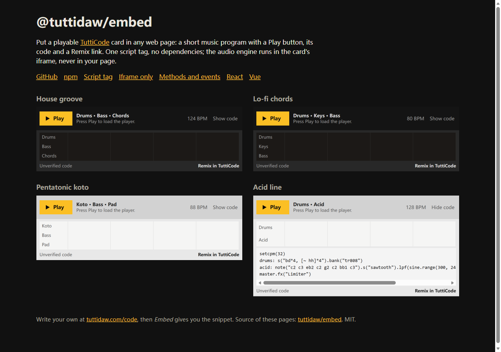

<p align="center"><strong>English</strong> · <a href="README.zh-CN.md">简体中文</a></p>

<h1 align="center">@tuttidaw/embed</h1>

<p align="center">
  <a href="https://www.npmjs.com/package/@tuttidaw/embed"></a>
  <a href="https://bundlephobia.com/package/@tuttidaw/embed"></a>
  <a href="LICENSE"></a>
</p>

<p align="center"><strong>Playable music code in any web page.</strong></p>

Put a playable [TuttiCode](https://tuttidaw.com/code) card in any web page: a short music program (TuttiCode, Strudel-compatible) with a Play button, its code and a *Remix in TuttiCode* link. One script tag and no dependencies. The audio engine never ships to your page: the card is an `<iframe>` on tuttidaw.com that runs the program, and the SDK talks to it with `postMessage`.

[](https://tuttidaw.github.io/embed/)

**Live examples: [tuttidaw.github.io/embed](https://tuttidaw.github.io/embed/)** (click the picture).

## Samples

Each program below plays on the live page and opens in the TuttiCode editor.

| Sample | What you hear | |
| --- | --- | --- |
| **House groove** | tr909 drums, a saw bass, e-piano chords | [▶ Play in TuttiCode](https://tuttidaw.com/code#c2V0Y3BtKDMxKQpkcnVtczogcygiYmQqNCwgW34gaGhdKjQsIH4gY3AgfiBjcCIpLmJhbmsoInRyOTA5IikKYmFzczogbm90ZSgiPFthMSB%2BIGExIGEyXSBbZjEgfiBmMSBmMl0gW2MyIH4gYzIgYzNdIFtnMSB%2BIGcxIGcyXT4iKS5zKCJzYXd0b290aCIpLmxwZig2MDApCmNob3JkczogY2hvcmQoIjxBbTkgRl43IENeNyBHNj4iKS52b2ljaW5nKCkuc3RydWN0KCJ%2BIHggfiB4IikucygiZ21fZXBpYW5vMSIpLmZ4KCJSZXZlcmIiKQptYXN0ZXIuZngoIkxpbWl0ZXIiKQ%3D%3D) |
| **Lo-fi chords** | tr707 drums, ninth chords, acoustic bass | [▶ Play in TuttiCode](https://tuttidaw.com/code#c2V0Y3BtKDIwKQpkcnVtczogcygiYmQgfiBbfiBiZF0gfiwgfiBzZCwgaGgqOCIpLmJhbmsoInRyNzA3IikuZ2FpbigwLjgpCmtleXM6IGNob3JkKCI8Rm05IEJibTkgRWJeOSBBYl43PiIpLnZvaWNpbmcoKS5zKCJnbV9lcGlhbm8xIikuZngoIlJldmVyYiIpCmJhc3M6IG5vdGUoIjxmMSBiYjEgZWIxIGFiMT4iKS5zKCJnbV9hY291c3RpY19iYXNzIikKbWFzdGVyLmZ4KCJMaW1pdGVyIik%3D) |
| **Pentatonic koto** | a koto melody over a warm pad | [▶ Play in TuttiCode](https://tuttidaw.com/code#c2V0Y3BtKDIyKQprb3RvOiBuKCIwIDIgNCA8NyA1PiA0IDIiKS5zY2FsZSgiRDU6bWlub3I6cGVudGF0b25pYyIpLnMoImdtX2tvdG8iKQpiYXNzOiBub3RlKCI8ZDIgYTEgYmIxIGMyPiIpLnMoImdtX2Fjb3VzdGljX2Jhc3MiKQpwYWQ6IGNob3JkKCI8RG0gQW0gQmIgQz4iKS52b2ljaW5nKCkucygiZ21fcGFkX3dhcm0iKS5nYWluKDAuNCk%3D) |
| **Acid line** | a resonant saw with a slow filter sweep | [▶ Play in TuttiCode](https://tuttidaw.com/code#c2V0Y3BtKDMyKQpkcnVtczogcygiYmQqNCwgW34gaGhdKjQiKS5iYW5rKCJ0cjgwOCIpCmFjaWQ6IG5vdGUoImMyIGMzIGViMiBjMiBnMiBjMiBiYjEgYzMiKS5zKCJzYXd0b290aCIpLmxwZihzaW5lLnJhbmdlKDMwMCwgMjQwMCkuc2xvdyg0KSkubHBxKDEyKS5nYWluKDAuNikKbWFzdGVyLmZ4KCJMaW1pdGVyIik%3D) |

## Examples

| Example | Shows | Source |
| --- | --- | --- |
| [Gallery](https://tuttidaw.github.io/embed/) | four cards, dark and light themes, `loops`, `show-code` | [source](index.html) |
| [Script tag](https://tuttidaw.github.io/embed/examples/script-tag.html) | `<script src=".../v1.js">` and one `<tuttidaw-code>` | [source](examples/script-tag.html) |
| [Iframe only](https://tuttidaw.github.io/embed/examples/iframe.html) | no script at all: the player URL with the program in the fragment | [source](examples/iframe.html) |
| [Methods and events](https://tuttidaw.github.io/embed/examples/controls.html) | `play()`, `stop()`, `setCode()` and the `tuttidaw:*` events | [source](examples/controls.html) |
| [React](https://tuttidaw.github.io/embed/examples/react.html) | `<TuttidawCode>` with a ref, no build step (esm.sh) | [source](examples/react.html) |
| [Vue 3](https://tuttidaw.github.io/embed/examples/vue.html) | the `TuttidawEmbed` plugin and `:code` binding | [source](examples/vue.html) |

## Quick start

```html
<script src="https://tuttidaw.com/embed/v1.js" defer></script>

<tuttidaw-code theme="dark" loops="4" code='setcpm(31)
drums: s("bd*4, [~ hh]*4, ~ cp ~ cp").bank("tr909")
bass: note("<[a1 ~ a1 a2] [f1 ~ f1 f2] [c2 ~ c2 c3] [g1 ~ g1 g2]>").s("sawtooth").lpf(600)'></tuttidaw-code>
```

## npm

```sh
npm install @tuttidaw/embed
```

```ts
import { defineTuttidawCode } from '@tuttidaw/embed';
defineTuttidawCode(); // registers <tuttidaw-code>

import { TuttidawCode } from '@tuttidaw/embed/react'; // React 17+
import { TuttidawEmbed } from '@tuttidaw/embed/vue'; // Vue 3 plugin
```

Attributes (`theme`, `loops`, `show-code`, `height`, `lang`, `snippet`, `src-fragment`), methods, events, the postMessage protocol and security notes: the [package README on npm](https://www.npmjs.com/package/@tuttidaw/embed).

## Make your own

Write a program at [tuttidaw.com/code](https://tuttidaw.com/code), then *Export & Share → Embed* gives you the snippet, or *Publish* gives a fixed id (`<tuttidaw-code snippet="...">`). Agents can write programs too: see [tuttidaw/tutticode](https://github.com/tuttidaw/tutticode).

## This repository

The examples site (GitHub Pages) and this README. It is published from TuttiDAW's main repository, where the package is developed and tested; issues and pull requests are welcome here and are carried over.

## License

MIT
