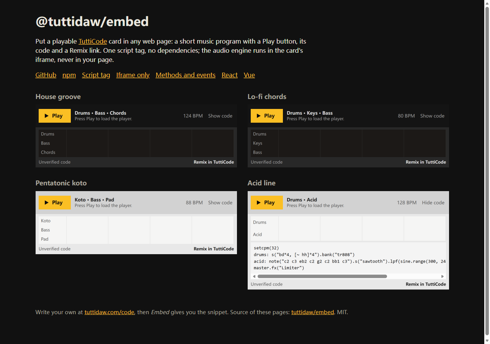

<p align="center"><a href="README.md">English</a> · <strong>简体中文</strong></p>

<h1 align="center">@tuttidaw/embed</h1>

<p align="center">
  <a href="https://www.npmjs.com/package/@tuttidaw/embed"></a>
  <a href="https://bundlephobia.com/package/@tuttidaw/embed"></a>
  <a href="LICENSE"></a>
</p>

<p align="center"><strong>在任何网页里放一段可以播放的音乐代码。</strong></p>

在任何网页里放一张可以播放的 [TuttiCode](https://tuttidaw.com/code) 卡片：一段简短的音乐程序（TuttiCode，兼容 Strudel），带播放按钮、代码视图和“在 TuttiCode 中改编”链接。只需一个 script 标签，没有任何依赖。音频引擎不会进入你的页面：卡片是 tuttidaw.com 上的一个 `<iframe>`，程序在里面运行，SDK 通过 `postMessage` 和它通信。

[](https://tuttidaw.github.io/tutticode-player/)

**在线示例：[tuttidaw.github.io/tutticode-player](https://tuttidaw.github.io/tutticode-player/)**（点击图片打开）。

## 样本

下面每段程序都能在在线页面播放，也能在 TuttiCode 编辑器里打开。

| 样本 | 听到的内容 | |
| --- | --- | --- |
| **House groove** | tr909 drums, a saw bass, e-piano chords | [▶ 在 TuttiCode 中播放](https://tuttidaw.com/code#c2V0Y3BtKDMxKQpkcnVtczogcygiYmQqNCwgW34gaGhdKjQsIH4gY3AgfiBjcCIpLmJhbmsoInRyOTA5IikKYmFzczogbm90ZSgiPFthMSB%2BIGExIGEyXSBbZjEgfiBmMSBmMl0gW2MyIH4gYzIgYzNdIFtnMSB%2BIGcxIGcyXT4iKS5zKCJzYXd0b290aCIpLmxwZig2MDApCmNob3JkczogY2hvcmQoIjxBbTkgRl43IENeNyBHNj4iKS52b2ljaW5nKCkuc3RydWN0KCJ%2BIHggfiB4IikucygiZ21fZXBpYW5vMSIpLmZ4KCJSZXZlcmIiKQptYXN0ZXIuZngoIkxpbWl0ZXIiKQ%3D%3D) |
| **Lo-fi chords** | tr707 drums, ninth chords, acoustic bass | [▶ 在 TuttiCode 中播放](https://tuttidaw.com/code#c2V0Y3BtKDIwKQpkcnVtczogcygiYmQgfiBbfiBiZF0gfiwgfiBzZCwgaGgqOCIpLmJhbmsoInRyNzA3IikuZ2FpbigwLjgpCmtleXM6IGNob3JkKCI8Rm05IEJibTkgRWJeOSBBYl43PiIpLnZvaWNpbmcoKS5zKCJnbV9lcGlhbm8xIikuZngoIlJldmVyYiIpCmJhc3M6IG5vdGUoIjxmMSBiYjEgZWIxIGFiMT4iKS5zKCJnbV9hY291c3RpY19iYXNzIikKbWFzdGVyLmZ4KCJMaW1pdGVyIik%3D) |
| **Pentatonic koto** | a koto melody over a warm pad | [▶ 在 TuttiCode 中播放](https://tuttidaw.com/code#c2V0Y3BtKDIyKQprb3RvOiBuKCIwIDIgNCA8NyA1PiA0IDIiKS5zY2FsZSgiRDU6bWlub3I6cGVudGF0b25pYyIpLnMoImdtX2tvdG8iKQpiYXNzOiBub3RlKCI8ZDIgYTEgYmIxIGMyPiIpLnMoImdtX2Fjb3VzdGljX2Jhc3MiKQpwYWQ6IGNob3JkKCI8RG0gQW0gQmIgQz4iKS52b2ljaW5nKCkucygiZ21fcGFkX3dhcm0iKS5nYWluKDAuNCk%3D) |
| **Acid line** | a resonant saw with a slow filter sweep | [▶ 在 TuttiCode 中播放](https://tuttidaw.com/code#c2V0Y3BtKDMyKQpkcnVtczogcygiYmQqNCwgW34gaGhdKjQiKS5iYW5rKCJ0cjgwOCIpCmFjaWQ6IG5vdGUoImMyIGMzIGViMiBjMiBnMiBjMiBiYjEgYzMiKS5zKCJzYXd0b290aCIpLmxwZihzaW5lLnJhbmdlKDMwMCwgMjQwMCkuc2xvdyg0KSkubHBxKDEyKS5nYWluKDAuNikKbWFzdGVyLmZ4KCJMaW1pdGVyIik%3D) |

## 示例

| 示例 | 演示内容 | 源码 |
| --- | --- | --- |
| [作品墙](https://tuttidaw.github.io/tutticode-player/) | 四张卡片，深色和浅色主题，`loops`、`show-code` | [源码](index.html) |
| [Script 标签](https://tuttidaw.github.io/tutticode-player/examples/script-tag.html) | `<script src=".../v1.js">` 加一个 `<tuttidaw-code>` | [源码](examples/script-tag.html) |
| [只用 iframe](https://tuttidaw.github.io/tutticode-player/examples/iframe.html) | 完全不用脚本：程序放在播放器 URL 的片段里 | [源码](examples/iframe.html) |
| [方法和事件](https://tuttidaw.github.io/tutticode-player/examples/controls.html) | `play()`、`stop()`、`setCode()` 和 `tuttidaw:*` 事件 | [源码](examples/controls.html) |
| [React](https://tuttidaw.github.io/tutticode-player/examples/react.html) | 带 ref 的 `<TuttidawCode>`，无需构建（esm.sh） | [源码](examples/react.html) |
| [Vue 3](https://tuttidaw.github.io/tutticode-player/examples/vue.html) | `TuttidawEmbed` 插件和 `:code` 绑定 | [源码](examples/vue.html) |

## 快速开始

```html
<script src="https://tuttidaw.com/embed/v1.js" defer></script>

<tuttidaw-code theme="dark" loops="4" code='setcpm(31)
drums: s("bd*4, [~ hh]*4, ~ cp ~ cp").bank("tr909")
bass: note("<[a1 ~ a1 a2] [f1 ~ f1 f2] [c2 ~ c2 c3] [g1 ~ g1 g2]>").s("sawtooth").lpf(600)'></tuttidaw-code>
```

## npm

```sh
npm install @tuttidaw/embed
```

```ts
import { defineTuttidawCode } from '@tuttidaw/embed';
defineTuttidawCode(); // registers <tuttidaw-code>

import { TuttidawCode } from '@tuttidaw/embed/react'; // React 17+
import { TuttidawEmbed } from '@tuttidaw/embed/vue'; // Vue 3 plugin
```

属性（`theme`、`loops`、`show-code`、`height`、`lang`、`snippet`、`src-fragment`）、方法、事件、postMessage 协议和安全说明，见 [npm 上的包说明](https://www.npmjs.com/package/@tuttidaw/embed)。

## 做你自己的

在 [tuttidaw.com/code](https://tuttidaw.com/code) 写一段程序，然后 *Export & Share → Embed* 会给你嵌入代码，*Publish* 会给一个固定 id（`<tuttidaw-code snippet="...">`）。Agent 也能写程序：见 [tuttidaw/tutticode](https://github.com/tuttidaw/tutticode)。

## 这个仓库

示例站点（GitHub Pages）和本 README。它从 TuttiDAW 主仓库发布，包在主仓库里开发和测试；欢迎在这里提 issue 和 PR，我们会同步过去。

## 许可证

MIT
